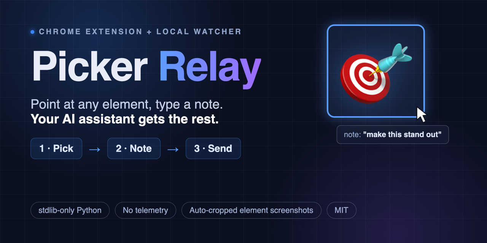
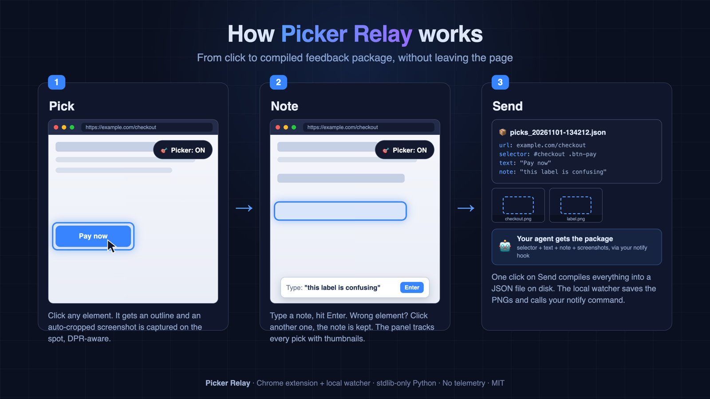

# Picker Relay



**Point at any webpage element, type a note, and your AI assistant gets a compiled feedback package: element selector, element text, your note, and an auto-cropped screenshot of exactly what you picked.**

No copy-pasting DOM paths. No "the button on the left, under the thing." One click per element, one file at the end.

## Built for agent-assisted workflows

Picker Relay was built for [Hermes Agent](https://hermes-agent.nousresearch.com): you browse, you pick, you type a note, and your agent receives everything it needs to act, delivered as plain files on your own machine. No cloud round-trip, no browser-in-the-loop gymnastics.

It works just as well for any team. Picks land as JSON + PNGs locally, and a notify hook of your choice decides where they go: a Discord or Slack webhook, a desktop notification, an email script, or the CLI of your AI agent.

## What it does

- Floating **Picker: ON/OFF** button on every page (nothing to arm, survives restarts)
- Click any element -> type a note -> Enter. Wrong element? Just click another one, the note is kept
- Screenshots are captured at pick time and cropped to the element (DPR-aware)
- A panel lists all picks with thumbnail previews (click to zoom), per-item remove
- One click on **Send** compiles everything into a single JSON file on disk
- A local watcher process picks it up, saves the screenshots, and calls your notify hook

Nothing ever leaves your machine except through the notify command you configure.



## Install (extension)

1. Download or clone this repo
2. Chrome -> `chrome://extensions` -> enable **Developer mode**
3. **Load unpacked** -> select the repo folder (the one containing `manifest.json`)

Note: Chrome 137+ silently ignores the `--load-extension` flag, so "Load unpacked"
is the way. Chrome for Testing / Chromium builds honor both.

## Install (watcher)

```bash
python3 relay.py                       # defaults: watch ~/Downloads/picker-relay
```

The watcher is stdlib-only Python 3. No dependencies, no install step.

Configure with environment variables:

```bash
export PICKER_WATCH_DIR="$HOME/Downloads/picker-relay"   # extension drop folder
export PICKER_INBOX_DIR="$HOME/.picker-relay"            # processed payloads + PNGs
export PICKER_NOTIFY_CMD='curl -s -X POST -H "Content-Type: application/json" \
  -d "$(jq -Rs {content:.} %f | jq .content=.. )" https://discord.com/api/webhooks/XXX'
```

`PICKER_NOTIFY_CMD` gets `%f` (path to the compiled message text) and `%m`
(space-separated PNG paths). Point it at your agent's CLI and every pick session
arrives as a ready-to-read briefing.

Run it forever with launchd (macOS) or systemd (Linux). Sample launchd plist:

```xml
<plist version="1.0"><dict>
  <key>Label</key><string>com.example.picker-relay</string>
  <key>ProgramArguments</key><array><string>python3</string><string>/path/to/relay.py</string></array>
  <key>RunAtLoad</key><true/>
  <key>KeepAlive</key><true/>
</dict></plist>
```

## Daily cleanup

Screenshots and payloads accumulate. Prune with cron/launchd:

```bash
find ~/.picker-relay ~/Downloads/picker-relay -type f \
  \( -name '*.png' -o -name 'picks_*.json' \) -mmin +2880 -delete
```

## Files

- `manifest.json` - MV3 manifest (permissions: tabs, downloads; host: <all_urls>)
- `picker.js` - content script: button, picker, note box, panel, thumbnails, Send
- `background.js` - service worker: full-tab capture + element crop, downloads-based relay
- `relay.py` - stdlib-only watcher (no dependencies)

## Privacy

No telemetry, no network calls from the extension, no accounts. The only
network request is whatever your own `PICKER_NOTIFY_CMD` makes.

## License

MIT
